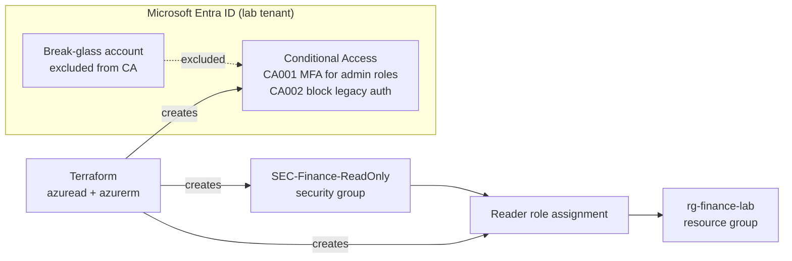

# Azure IAM Security Lab

Identity hardening on Microsoft Entra ID (least privilege, Conditional Access
and MFA), provisioned with Terraform so the whole lab can be rebuilt, reviewed
and torn down on demand.

## Context and objective

Most cloud intrusions start with an identity, not an exploit: a phished or
sprayed password, an admin account without MFA, or a user with far more rights
than the job requires. The controls against this (Conditional Access, MFA,
least-privilege role assignments) are usually configured by hand in the portal,
which makes them hard to review, reproduce or audit.

The objective of this lab is to express those controls **as code**: a small,
readable Terraform configuration that creates the policies and role
assignments, deploys them safely in report-only mode first, and can be
destroyed and rebuilt at any time.

## Architecture

| File | What it creates |
| --- | --- |
| [`terraform/main.tf`](terraform/main.tf) | Providers, the finance security group, the Reader role assignment |
| [`terraform/conditional_access.tf`](terraform/conditional_access.tf) | CA001 (require MFA for admin roles) and CA002 (block legacy authentication) |
| [`terraform/variables.tf`](terraform/variables.tf) | Tenant, subscription, break-glass account, resource group and policy state inputs |
| [`terraform/README.md`](terraform/README.md) | How to run it safely |

## Technologies

- **Microsoft Entra ID**: users, groups, directory roles, Conditional Access
  (requires Entra ID P1; a P2 trial covers it)
- **Azure RBAC**: role assignment on a resource group
- **Terraform** with the `azuread` (~> 3.0) and `azurerm` (~> 4.0) providers
- **GitHub Actions**: `terraform fmt`, `terraform validate` and `tflint` on
  every push

## What this project demonstrates

- The difference between **Entra ID directory roles** (control the tenant) and
  **Azure RBAC roles** (control resources), and where each is used.
- Writing Conditional Access policies as code, with an emergency-access
  exclusion so a bad policy cannot lock out the tenant.
- A safe rollout: report-only first, review the sign-in logs, then enforce.
- Applying least privilege with a built-in role (Reader instead of Contributor
  or Owner) scoped to a single resource group.
- Treating identity configuration like any other code: versioned, linted and
  reviewable.

## Technical choices and trade-offs

| Choice | Why | Trade-off |
| --- | --- | --- |
| Terraform with `azuread` and `azurerm` | One tool and one workflow for both Entra ID objects and Azure resources | Provider updates can lag behind new Entra ID features |
| `ca_state` defaults to report-only (`enabledForReportingButNotEnforced`) | A new policy cannot lock anyone out until its impact has been reviewed | Enforcement is a second, manual step |
| Break-glass account passed in as an object ID, not created by Terraform | Its credentials never end up in the Terraform state | The account has to be created by hand before the first apply |
| Admin roles targeted by their built-in template IDs | These IDs are identical in every tenant, so no lookup is needed | Less readable, hence the inline comments |
| Existing resource group read with a data source | The lab only manages the access, not the lifecycle of the resource group | The resource group must exist before `apply` |
| Validation on `ca_state` | A typo in the policy state fails at `plan` time instead of in the tenant | None |

## Security

**Threats addressed:**

| Control | Threat | MITRE ATT&CK |
| --- | --- | --- |
| CA001: require MFA for Global and Security Administrators | Use of a stolen or guessed admin password | T1078.004 Valid Accounts: Cloud Accounts |
| CA002: block legacy authentication clients | Password spraying through protocols that cannot do MFA | T1110.003 Password Spraying |
| Reader on one resource group instead of Contributor or Owner | Abuse of excessive rights after an account compromise | T1078.004 (limits the impact) |

**Risks taken into account:**

- **Tenant lockout**: every policy excludes the break-glass account, and
  policies start in report-only mode.
- **Secrets in the repository**: no credentials are needed in the code (the
  Azure CLI session is used). `*.tfstate` and `*.tfvars` are git-ignored
  because they contain tenant and object IDs.
- **Lab only**: everything runs in a dedicated lab tenant, never in a
  production tenant.

## Installation and reproduction

Prerequisites, commands and teardown are detailed in
[`terraform/README.md`](terraform/README.md). In short:

1. Create a lab tenant with Entra ID P1 or P2, a resource group
   `rg-finance-lab` and a cloud-only break-glass account.
2. Log in with `az login --tenant <tenant-id>`.
3. Run `terraform init`, then `terraform plan` and `terraform apply` with the
   `tenant_id`, `subscription_id` and `break_glass_object_id` variables.
4. Review **Entra ID > Sign-in logs > Conditional Access** while the policies
   are in report-only mode.
5. Re-apply with `-var="ca_state=enabled"` to enforce, and run
   `terraform destroy` when done.

## Results

Expected behaviour of each control once enforced:

| Scenario | Policy | Expected result |
| --- | --- | --- |
| Block legacy authentication | CA002: legacy clients → Block | Basic-auth sign-ins denied |
| Require MFA for admin roles | CA001: directory roles → Require MFA | Admins must complete MFA to sign in |
| Least privilege on a resource group | RBAC: Reader | Finance users can view but not modify resources |

Every push is checked by the
[Terraform workflow](.github/workflows/terraform.yml): formatting, validation
against the provider schemas, and `tflint`.

## Limits and what I would do in production

- **Local state.** The state stays on the operator's machine. In production
  it would live in a remote backend (an Azure Storage account with locking,
  encryption and restricted access), because it lists every object ID in the
  tenant.
- **Applied from a user session.** Terraform runs with the operator's own
  Azure CLI login. In production it would run from a pipeline using workload
  identity federation (OIDC), with a service principal holding only the Graph
  and RBAC permissions it needs, and `plan` reviewed in a pull request before
  any `apply`.
- **MFA, not phishing-resistant MFA.** CA001 accepts any MFA method. For
  administrators, production should require an authentication strength such
  as FIDO2 or Windows Hello for Business.
- **Standing admin rights.** Admins hold their roles permanently. Production
  would use PIM for just-in-time activation, with approval and access reviews.
- **One break-glass account, not monitored.** Production needs two
  emergency-access accounts with strong credentials stored offline, and an
  alert on every sign-in.
- **Only two policies.** A production baseline also covers all users (not only
  admins), risky sign-ins, device compliance and named locations.
- **Legacy authentication is already largely retired** by Microsoft on
  Exchange Online, so CA002 is mostly defence in depth for remaining legacy
  clients.

## Next steps

- Publish the report-only sign-in log review and enforcement tests
- Add PIM (just-in-time admin roles) and Access Reviews
- Add a compliant-device Conditional Access policy
- Move the state to a remote backend and run `plan` on pull requests with OIDC

## License

[MIT](LICENSE)
